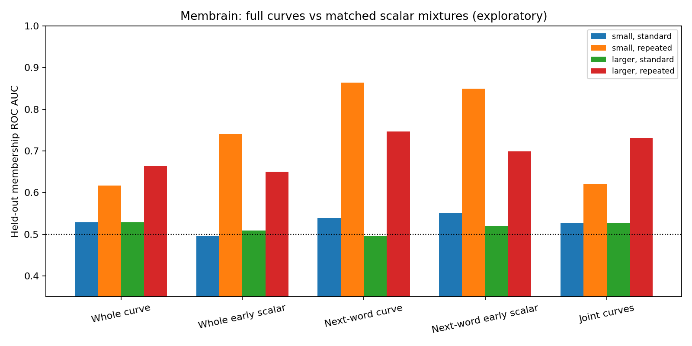
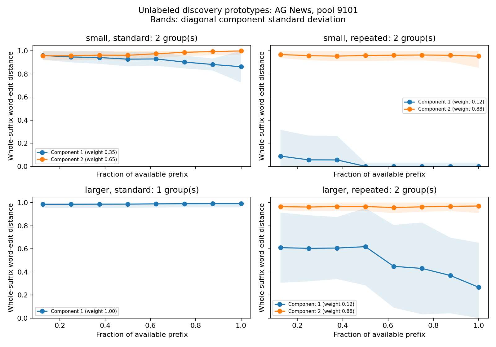

# Membrain: full recovery curves, unsupervised clustering

Exploratory reanalysis of 16 cached small-model targets; zero new model queries. Each mixture fits 128 unlabeled discovery sentences and is evaluated on 128 separate sentences. These data were inspected in earlier experiments: this is not fresh confirmation.

Eight whole-suffix word-edit distances are retained per sentence. A second curve contains next-word mismatch frequencies from 16 returned completions per prefix. Diagonal Gaussian mixtures choose one/two components using unlabeled BIC. The lower-distance prototype names the high-recovery group. One component means abstention; its AUC is 0.5. Scores are group posteriors, not calibrated membership probabilities.

| Method | Mean held-out membership AUC | Targets selecting 1 / 2 / 3 groups |
|---|---:|---:|
| Whole curve | 0.5847 | 2 / 14 / 0 |
| Next-word curve | 0.6610 | 3 / 13 / 0 |
| Joint curves | 0.6014 | 3 / 13 / 0 |
| Whole early scalar | 0.5992 | 5 / 11 / 0 |
| Next-word early scalar | 0.6552 | 3 / 13 / 0 |
| Whole mean scalar | 0.6040 | 4 / 12 / 0 |
| Next-word mean scalar | 0.6527 | 3 / 13 / 0 |
| Whole curve up-to3 | 0.5628 | 2 / 6 / 8 |
| Whole raw recovery | 0.6235 | raw ranking |
| Next-word raw recovery | 0.6742 | raw ranking |

Matched scalar controls use the same resampled curves, discovery split, mixture family and fitting settings.

| Capacity / exposure | Whole curve | Whole early scalar | Next-word curve | Next-word early scalar | Joint curves |
|---|---:|---:|---:|---:|---:|
| small / standard | 0.5292 | 0.4967 | 0.5389 | 0.5515 | 0.5280 |
| small / repeated | 0.6169 | 0.7404 | 0.8634 | 0.8494 | 0.6197 |
| larger / standard | 0.5291 | 0.5095 | 0.4956 | 0.5207 | 0.5267 |
| larger / repeated | 0.6635 | 0.6503 | 0.7463 | 0.6993 | 0.7311 |

## Paired per-target comparisons

| Curve vs matched early scalar | Mean AUC difference | Targets with bootstrap CI above / below zero |
|---|---:|---:|
| Whole curve vs Whole early scalar | -0.0145 | 1 / 4 |
| Next-word curve vs Next-word early scalar | +0.0058 | 1 / 0 |
| Joint curves vs Next-word early scalar | -0.0539 | 1 / 4 |

Intervals use 1,000 paired stratified sentence bootstraps conditional on each fitted model and cached query set. They omit fit/query/training uncertainty and multiplicity adjustment. Targets share some sentences.

## Interpretation

Curve shape contains information beyond an average, but clustering recovery patterns does not by itself identify training membership. Read the standard-exposure rows separately from repeated exposure. Report all controls rather than selecting a winner on these labels. No default detector is promoted from this exploratory comparison.

Diagonal covariance ignores correlations between prefix distances; BIC under this approximation can overselect components. The joint input has 16 coordinates but only 128 discovery examples. Whole-suffix difficulty also changes as the suffix shrinks. These tiny local models establish no performance claim for commercial or billion-parameter models.

Per-target metrics, group precision/recall, high-exposure AUC, bootstrap intervals, frozen source hashes, unlabeled features, fitted mixtures and held-out scores are retained in this directory.

