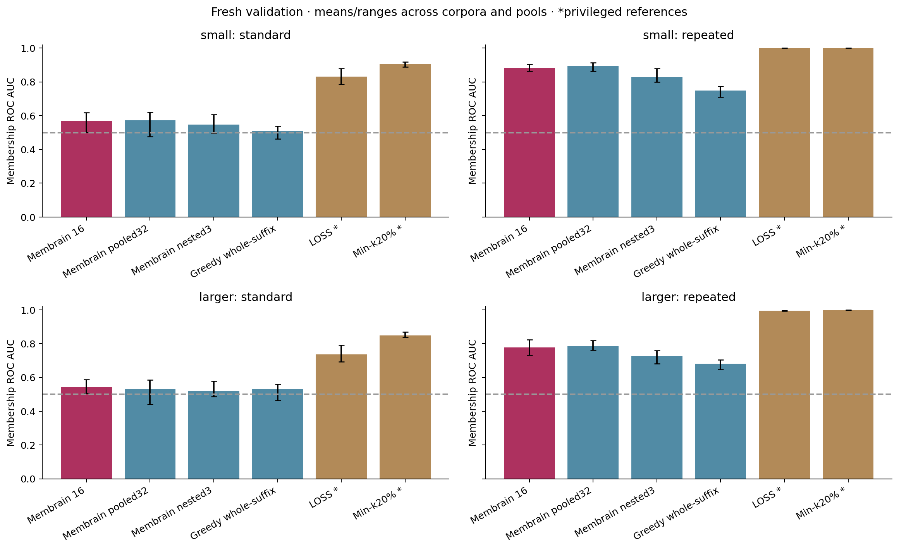
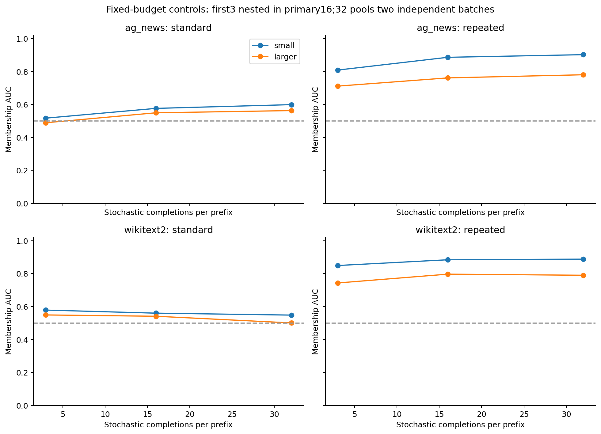
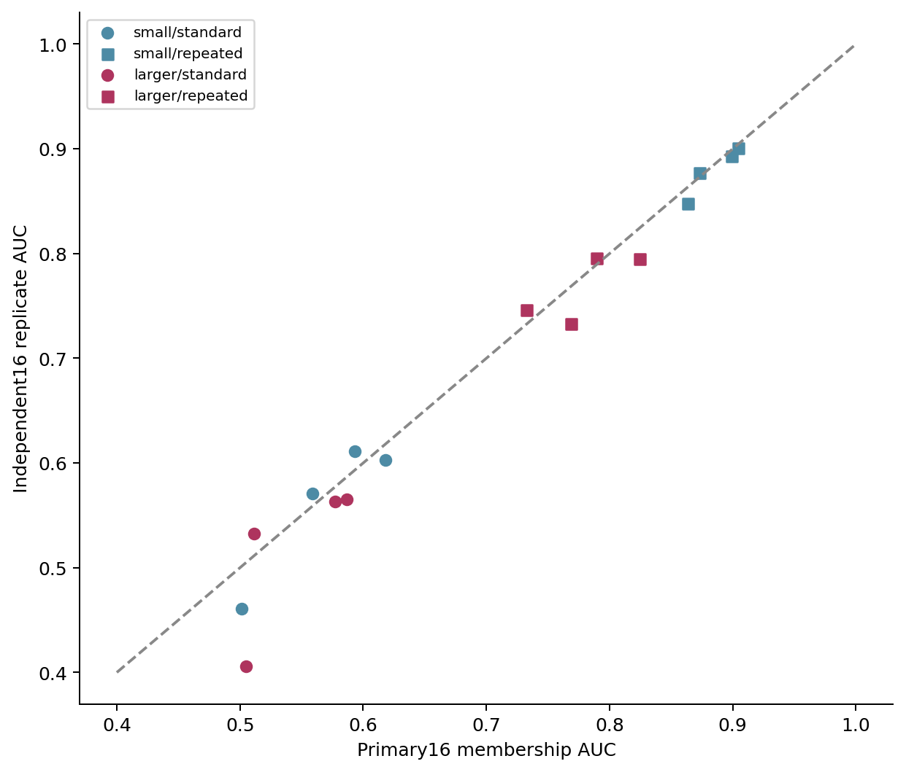
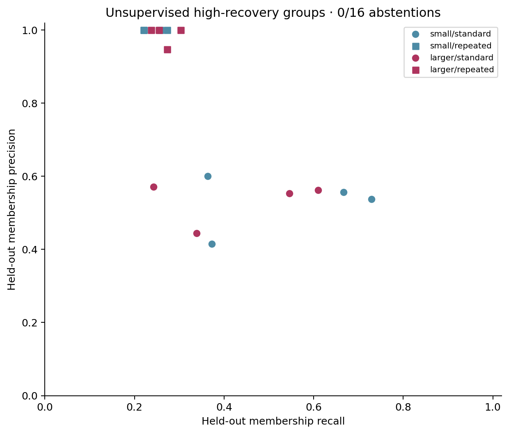
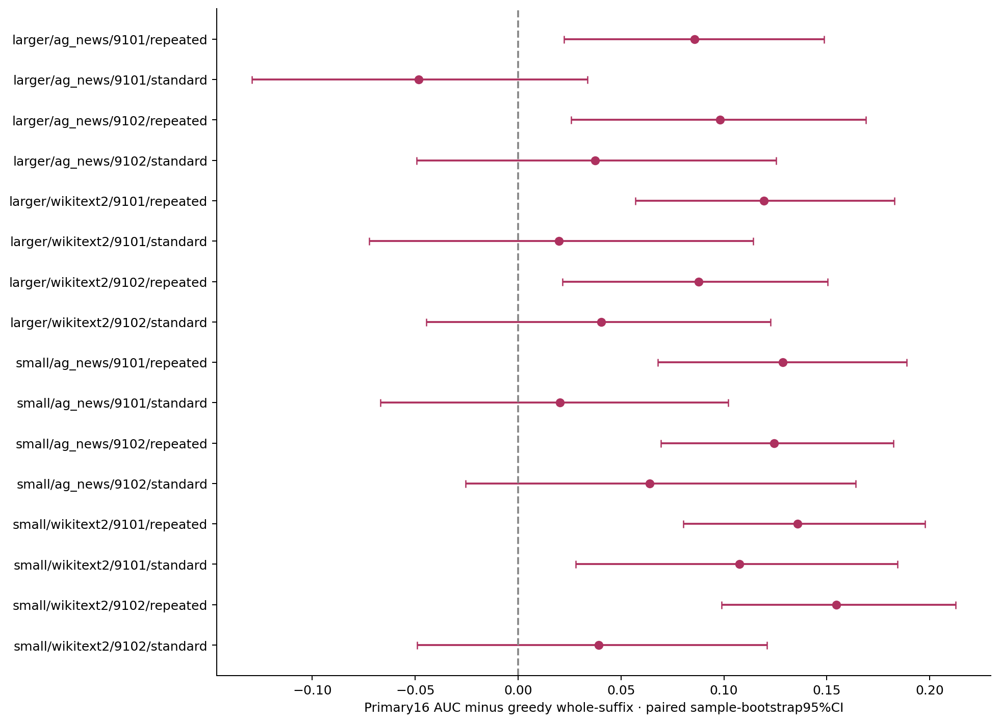
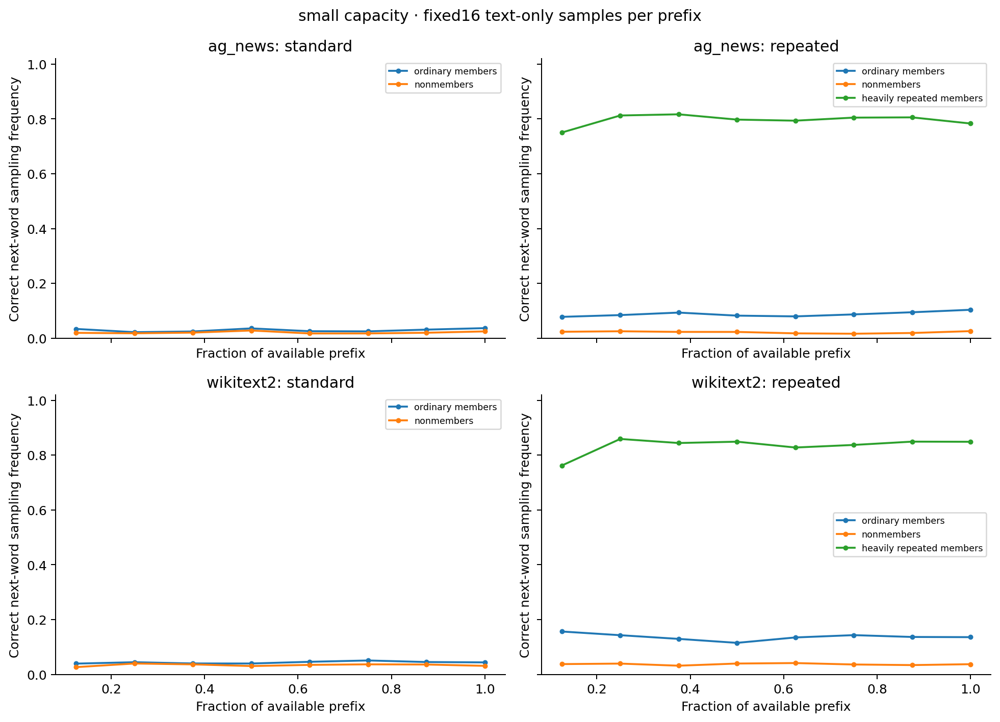
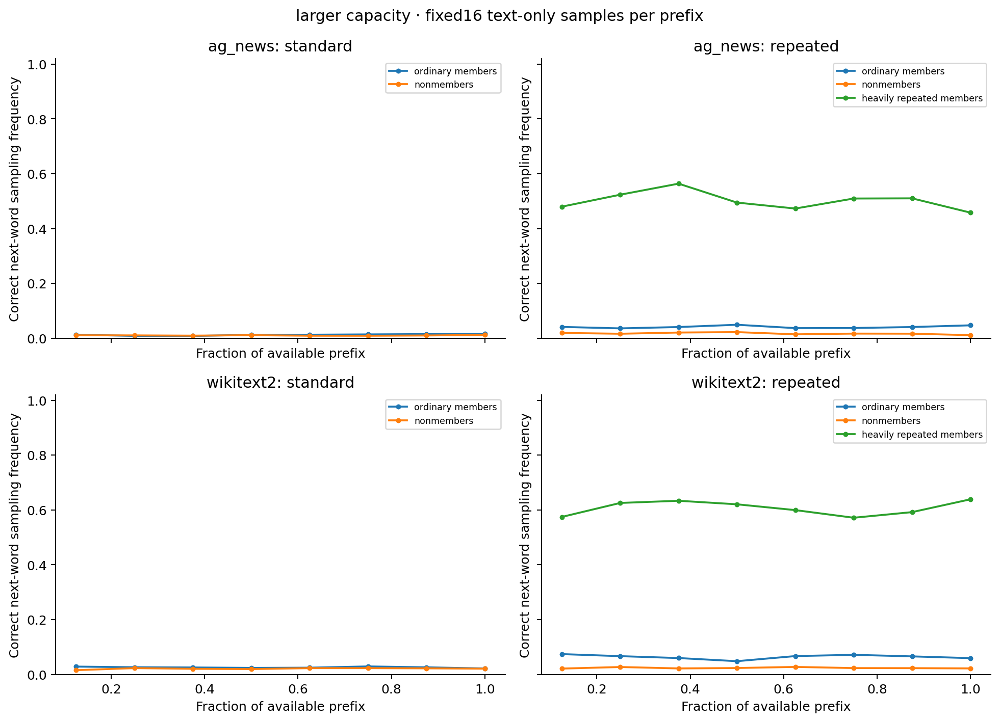

# Membrain next-word recovery: prospective fresh-data validation

**Same fixed score; fresh sentences, fresh target models, two capacities, independent query replication.** The attacker sees completion strings only. No membership labels enter score/model selection, unlabeled mixture fitting, component orientation, or calibration. Target-training/evaluation labels are used by the benchmark owner, separately from attack inference.

## Protocol and scope

Primary16 is the EXACT development score: up to eight increasing word prefixes, 16 IID temperature 0.8 short completions (cap 8 new tokens), count correct first lexical words, Jeffreys smoothing(h+.5)/17, and early-weighted log-frequency area. The eight-stage grid is deduplicated when word counts coincide. The method estimates a text-event probability; it never reads the model’s true token probabilities. The primary score and generation settings were not changed in this study.

Two new 384-sentence pools per corpus: AG News train-source descriptions and WikiText-2 validation-source paragraphs, excluding all previous exact document chunks/full reference sentences and tokenizer background. 16 targets = two capacities × two corpora × two exposure regimes × two seeds. Seeds 9101/9102 use separate pools. Capacities/regimes share a seed’s pool and membership assignment; these are not 16 independent datasets. Each target evaluates 128 members/128 nonmembers, blindly shuffled before queries. Small 182,016 parameters; larger 458,592. Both are tiny local models, not commercial LLMs.

An independent 16-sample query repeat measures stability. 32-sample pooling and a nested 3-sample subset were predeclared secondary budget controls. Greedy whole-suffix generation provides an output-only baseline. LOSS/Min-k/SPW are privileged owner-side references computed only after scores and unlabeled mixtures are saved. No reference enters the detector.

## Primary comparison

| Method | Access | Macro membership AUC | TPR at ≤1%FPR | AP |
|---|---|---:|---:|---:|
| Membrain 16 | Completion text only | 0.6941 | 20.31% | 0.7047 |
| Membrain replicate16 | Completion text only | 0.6814 | 20.56% | 0.7006 |
| Membrain pooled32 | Completion text only | 0.6961 | 21.09% | 0.7091 |
| Membrain nested3 | Completion text only | 0.6555 | 18.85% | 0.6734 |
| Hard-prefix word probe | Completion text only | 0.5593 | 11.87% | 0.5593 |
| Greedy next-word | Completion text only | 0.6620 | 18.55% | 0.6716 |
| Greedy whole-suffix | Completion text only | 0.6182 | 14.84% | 0.6410 |
| Greedy fixed-tail | Completion text only | 0.5600 | 10.99% | 0.5857 |
| Length-only control | Completion text only | 0.4775 | 0.39% | 0.4779 |
| LOSS | Privileged probabilities | 0.8907 | 50.24% | 0.8684 |
| Min-k20% | Privileged probabilities | 0.9377 | 56.20% | 0.9240 |
| SPW-MIA | Privileged probabilities | 0.8403 | 42.77% | 0.8304 |

Primary16 minus greedy whole-suffix macro AUC: **+0.0759**. Development AUC was 0.7106 on previously evaluated data; compare it descriptively, not as a paired baseline. Fresh source partitions, capacities and pool structure changed. No best secondary result replaces the primary.

| Capacity / exposure | Primary16 | Replicate16 | Pooled32 | Nested3 | Greedy whole | Min-k20% |
|---|---:|---:|---:|---:|---:|---:|
| small/standard | 0.5678 | 0.5616 | 0.5733 | 0.5475 | 0.5101 | 0.9039 |
| small/repeated | 0.8848 | 0.8797 | 0.8948 | 0.8286 | 0.7490 | 1.0000 |
| larger/standard | 0.5450 | 0.5167 | 0.5315 | 0.5188 | 0.5327 | 0.8485 |
| larger/repeated | 0.7787 | 0.7676 | 0.7849 | 0.7270 | 0.6810 | 0.9984 |

## Heavy exposure as a separate target

Repeated conditions expose32 member sentences96 times each and other members12 times. This table ranks that known high-exposure group against all other candidates; it is not an oracle label for an internal memory state. Strong recovery and ordinary training membership are different detection targets.

| Text-only score | Small: high-exposure AUC | Larger: high-exposure AUC |
|---|---:|---:|
| Membrain 16 | 1.0000 | 0.9999 |
| Membrain replicate16 | 1.0000 | 0.9994 |
| Membrain pooled32 | 1.0000 | 0.9999 |
| Greedy next-word | 1.0000 | 0.9986 |
| Greedy whole-suffix | 1.0000 | 0.9967 |

### Exploratory subgroup check: remove the heaviest items

This descriptive check was added after the primary results. Exclude the96-presentation group from evaluation, leaving96 members seen12 times and128 nonmembers in each repeated target. Models are NOT retrained and no score/threshold is changed. This asks whether the ranking signal is entirely driven by the most repeated items; it is not a newly validated primary or an isolated causal estimate of repetition.

| Capacity | Primary16 AUC | Greedy whole-suffix AUC |
|---|---:|---:|
| small | 0.8464 | 0.6653 |
| larger | 0.7049 | 0.5756 |

## Every primary target and paired uncertainty

1000 paired stratified sample-bootstrap draws per target, conditional on fixed target/queries. Intervals omit training and generation-sampling uncertainty and multiple-comparison correction; query replication is reported separately.

| Target | Primary16 AUC | Δ vs greedy whole | Paired 95% CI | Replicate AUC |
|---|---:|---:|---|---:|
| larger/ag_news/9101/repeated | 0.7326 | +0.0856 | [+0.0223, +0.1486] | 0.7462 |
| larger/ag_news/9101/standard | 0.5117 | -0.0484 | [-0.1293, +0.0337] | 0.5327 |
| larger/ag_news/9102/repeated | 0.7894 | +0.0982 | [+0.0258, +0.1689] | 0.7959 |
| larger/ag_news/9102/standard | 0.5867 | +0.0375 | [-0.0493, +0.1252] | 0.5651 |
| larger/wikitext2/9101/repeated | 0.8240 | +0.1195 | [+0.0571, +0.1827] | 0.7952 |
| larger/wikitext2/9101/standard | 0.5771 | +0.0197 | [-0.0723, +0.1142] | 0.5633 |
| larger/wikitext2/9102/repeated | 0.7687 | +0.0876 | [+0.0215, +0.1505] | 0.7330 |
| larger/wikitext2/9102/standard | 0.5046 | +0.0405 | [-0.0446, +0.1228] | 0.4059 |
| small/ag_news/9101/repeated | 0.8727 | +0.1285 | [+0.0679, +0.1889] | 0.8768 |
| small/ag_news/9101/standard | 0.5590 | +0.0204 | [-0.0669, +0.1021] | 0.5711 |
| small/ag_news/9102/repeated | 0.8991 | +0.1244 | [+0.0693, +0.1824] | 0.8931 |
| small/ag_news/9102/standard | 0.5929 | +0.0640 | [-0.0256, +0.1640] | 0.6114 |
| small/wikitext2/9101/repeated | 0.9042 | +0.1358 | [+0.0802, +0.1978] | 0.9011 |
| small/wikitext2/9101/standard | 0.6178 | +0.1075 | [+0.0280, +0.1844] | 0.6031 |
| small/wikitext2/9102/repeated | 0.8632 | +0.1546 | [+0.0988, +0.2126] | 0.8477 |
| small/wikitext2/9102/standard | 0.5015 | +0.0391 | [-0.0491, +0.1209] | 0.4607 |

## Query noise and unsupervised held-out groups

Mixtures fit 128 unlabeled discovery scores, choose one vs two Gaussian components by BIC, orient by higher recovery, and evaluate 128 other sentences. They abstain if one component is preferred. No class is reoriented using labels. Component posterior is not calibrated membership probability. Precision depends on the held-out prevalence shown below.

| Target | Test members/nonmembers | Primary groups | Membership precision | Recall | Balanced accuracy | Query rank correlation | High-group Jaccard |
|---|---|---:|---:|---:|---:|---:|---:|
| larger/ag_news/9101/repeated | 66/62 | 2 | 0.947 | 0.273 | 0.628 | 0.854 | 0.253 |
| larger/ag_news/9101/standard | 66/62 | 2 | 0.554 | 0.545 | 0.539 | 0.527 | 0.565 |
| larger/ag_news/9102/repeated | 59/69 | 2 | 1.000 | 0.254 | 0.627 | 0.877 | 0.652 |
| larger/ag_news/9102/standard | 59/69 | 2 | 0.562 | 0.610 | 0.602 | 0.550 | 0.631 |
| larger/wikitext2/9101/repeated | 66/62 | 2 | 1.000 | 0.303 | 0.652 | 0.843 | 0.833 |
| larger/wikitext2/9101/standard | 66/62 | 2 | 0.571 | 0.242 | 0.524 | 0.678 | 0.500 |
| larger/wikitext2/9102/repeated | 59/69 | 2 | 1.000 | 0.237 | 0.619 | 0.872 | 0.929 |
| larger/wikitext2/9102/standard | 59/69 | 2 | 0.444 | 0.339 | 0.488 | 0.656 | 0.431 |
| small/ag_news/9101/repeated | 66/62 | 2 | 1.000 | 0.273 | 0.636 | 0.913 | 0.818 |
| small/ag_news/9101/standard | 66/62 | 2 | 0.557 | 0.667 | 0.551 | 0.748 | 0.646 |
| small/ag_news/9102/repeated | 59/69 | 2 | 1.000 | 0.220 | 0.610 | 0.915 | 1.000 |
| small/ag_news/9102/standard | 59/69 | 2 | 0.537 | 0.729 | 0.596 | 0.664 | 0.500 |
| small/wikitext2/9101/repeated | 66/62 | 2 | 1.000 | 0.258 | 0.629 | 0.944 | 1.000 |
| small/wikitext2/9101/standard | 66/62 | 2 | 0.600 | 0.364 | 0.553 | 0.791 | 0.679 |
| small/wikitext2/9102/repeated | 59/69 | 2 | 1.000 | 0.220 | 0.610 | 0.934 | 1.000 |
| small/wikitext2/9102/standard | 59/69 | 2 | 0.415 | 0.373 | 0.462 | 0.775 | 0.515 |

Full primary/replicate/pooled group metrics are in `group_summary.json`. Gaussian mixtures on bounded/censored scores are heuristics; two components are not proof of member/nonmember classes. Weakly learned members and nonmembers may share low-recovery groups. Query noise can change grouping even when aggregate AUC is similar.

| Capacity / exposure | Query rank correlation | High-group Jaccard | No hits at any prefix: members | No hits: nonmembers |
|---|---:|---:|---:|---:|
| small/standard | 0.745 | 0.585 | 23.0% | 33.6% |
| small/repeated | 0.926 | 0.955 | 3.3% | 44.9% |
| larger/standard | 0.603 | 0.532 | 31.1% | 38.9% |
| larger/repeated | 0.861 | 0.667 | 14.5% | 49.6% |

## Interpretation and limits

The right validation question is whether ordinary training membership improves reliably, not merely whether heavily repeated sentences recover. Repeated exposure also changes optimization budget. Heavy exposure is known training frequency, not an oracle memory label. All conditions/capacities and controls are reported, including failures.

Short-generation caps can censor first words; rare correct words may never appear in 16 samples. `sampling_saturation.json` is a reporting diagnostic of candidates with zero matches at every probe, not a scoring or selection input. More samples change query costs and the smoothing floor; compare rankings within methods, not raw scores across budgets. Candidate word-count control checks a non-model metadata signal.

No large-model, external-domain or commercial-API performance claim follows. Exact exclusions do not remove semantic overlap; sentence segmentation/WikiText artifacts remain. At 128 nonmembers, empirical 1%FPR allows one false positive. No deployment threshold or calibrated membership probability is fitted. Prior research motivated the unchanged hypothesis; this is prospective internal confirmation, not externally preregistered replication.

Total completions including query repeats/greedy controls: **1,098,860**; backend generated tokens: **9,221,988**. Public prefix lengths are not suffix information; the API never receives the reference continuation. Raw transcripts and saved mixtures allow string-only replay without model weights or a model tokenizer.

See [frozen protocol](../../experiments/MEMBRAIN_TEXT_VALIDATION.md).

## Plots

